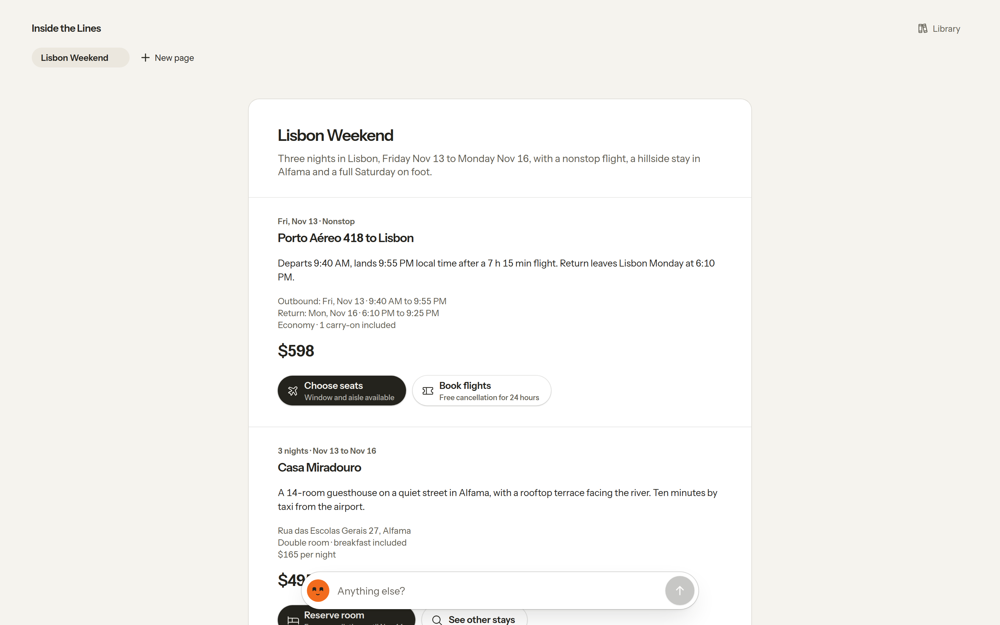
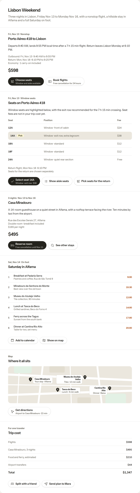
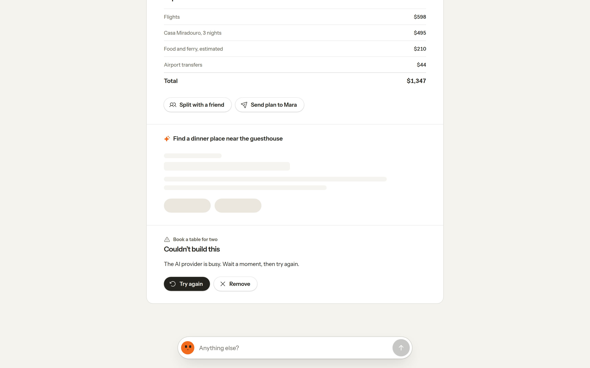
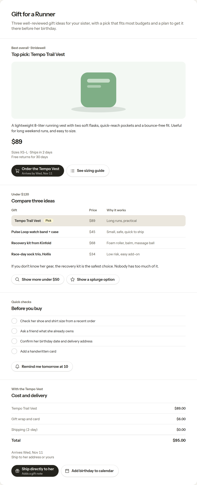
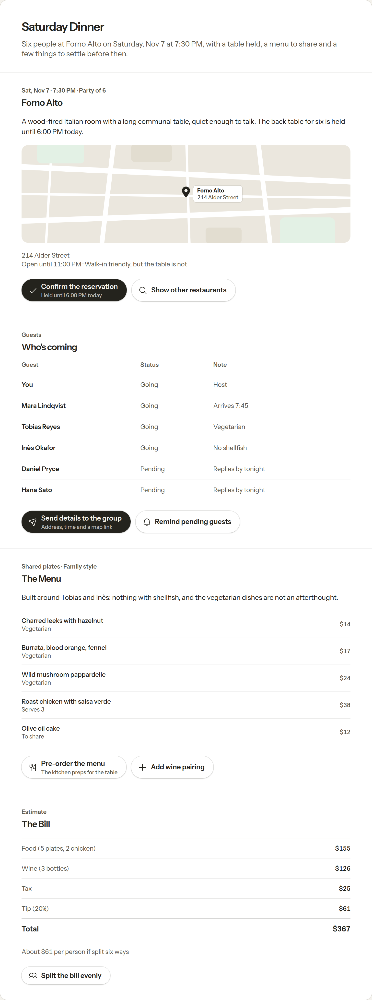
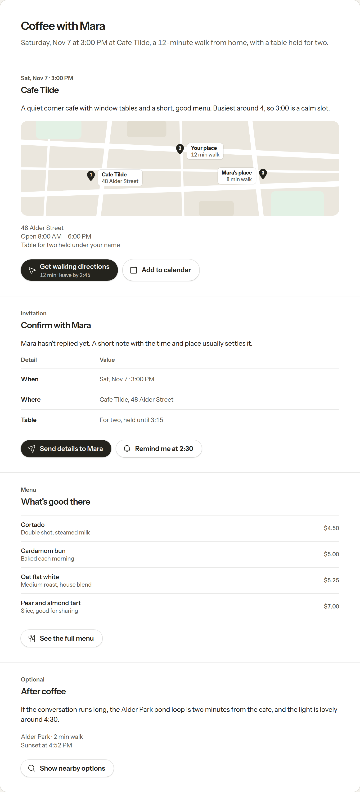
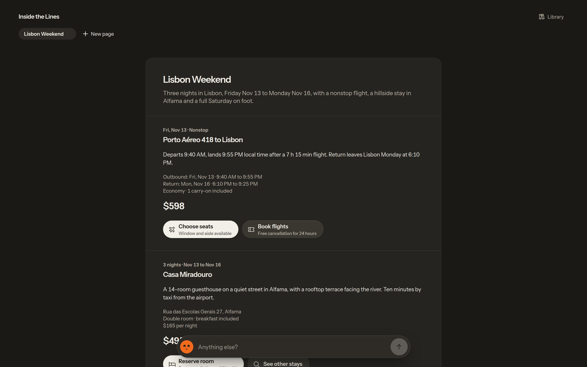

# Inside the Lines

**Say what you're planning, and an AI model builds a live page for it on the spot: the places, the times, the costs and the next steps. It never writes UI, so the page can't leave the design system.**

An experiment in generative UI: no apps, no folders, one page per task, made on the spot. It wears [Klementine](https://klementine.net)'s design, voice and face. All people, places and products in the examples are made up.



## Try it

```bash
git clone https://github.com/simon-lund/inside-the-lines.git
cd inside-the-lines
npm install
npm run dev
```

Open http://localhost:5173. The four examples are recorded and work **without an API key**. For anything else, copy `.env.example` to `.env` and set one key:

| Provider | Key | Default model (`AI_MODEL`) |
|---|---|---|
| Anthropic | `ANTHROPIC_API_KEY` | `claude-sonnet-5-5` |
| OpenAI | `OPENAI_API_KEY` | `gpt-6-luna` |
| Mistral | `MISTRAL_API_KEY` | `mistral-small-latest` |

With several keys set, `AI_PROVIDER` picks one.

## What you can do

- **Say what you're planning:** *"Plan a weekend in Lisbon"*. A page opens with a title, one sentence that sums up the plan, and the sections it needs.
- **Click an action.** An action that shows more (*Choose seats*, *See other stays*) builds a new section right below the one you clicked. One that settles something (*Reserve room*, *Add to calendar*) switches on the spot.
- **Ask for more.** *Anything else?* at the bottom adds a part to the page, under what you typed.
- **Tick things off, remove sections, keep several pages.** Pages stay in your browser.
- **See everything she can build** in the Library.

| An action adds a section below | Loading and errors stay in their section |
|---|---|
|  |  |

| Gift for a runner | Dinner for six | Coffee with Mara |
|---|---|---|
|  |  |  |

## Generated on the spot, kept on design

Letting a model generate UI live usually means one of two things: it looks great once and drifts every time after, or it's so constrained it can't surprise you. Here the model has a lot of room (any task, any content, any mix of sections), but it **never writes UI**. It fills in a fixed vocabulary, and the design system draws it.

```
intention ──► model ──► JSON in the page vocabulary ──► validator ──► design-system components
                                                       (guardrail)
```

1. **The vocabulary** ([`src/lib/os/spec.ts`](src/lib/os/spec.ts)): a page is a title, a lede and up to six sections. A section is a title, an optional kicker, up to six blocks and up to three actions. The blocks: text, meta, price, a map with up to four places, a table with a recommended row, a summary with a total, a checklist, a list, media, art. There is no block for HTML, no colour, no font, no layout.
2. **The validator** ([`src/lib/os/sanitize.ts`](src/lib/os/sanitize.ts)) drops unknown blocks and fields, caps every string and count, evens out table rows, and keeps one map and one primary action per section. Every rule has a test.
3. **One repair round:** if a reply is unusable (not JSON, no sections), the server tells the model what was wrong once, then gives up with a clear error.
4. **The renderer** ([`SpecSection.svelte`](src/lib/os/components/SpecSection.svelte)) maps each block to a design-system part. It's the only way anything reaches the page.

The model can't produce an off-design page, because there is nothing off-design for it to say. The [Library](src/routes/library/+page.svelte) shows every section the vocabulary allows, drawn by the same renderer; a test makes sure it covers every block type.


## The design

The pages follow Klementine's design system: flat and warm, light or dark with your system, depth from fine lines rather than shadows. One primary action per section, in the page's own ink. Orange belongs to the assistant and to the words that say when something happens: her face, and the times in a day plan. Type is Instrument Sans, icons are [Phosphor](https://phosphoricons.com).

Her face in the input follows the pointer, with the gaze maths of Klementine's companion, and shows how she's doing: listening while you type, working while a page is built, needing you when a section failed.



## How it's built

| Path | What |
|---|---|
| `src/routes/+page.svelte` | The pages: top bar, page, the input |
| `src/routes/library/` | The Library |
| `src/lib/os/` | Page vocabulary, validator (+ tests), Library sections (+ test), client state, components |
| `src/routes/api/os/` | Builds pages and sections: replay cache → model → validator → repair round |
| `src/lib/design/` | The design system: Canvas (the tokens), Page, Section, Action, MapView, Table, Summary, Checklist, … |
| `src/lib/server/ai/` | Providers: Anthropic, plus one adapter for the OpenAI-compatible Chat Completions API (OpenAI, Mistral) |
| `os-demo/` | Recorded examples, replayed without a key |

**Recordings.** Every result is cached by *what was clicked* (the intention, or the section and action), so the same click replays the same answer in any order. A recording keeps the model's reply as it came, and replays pass the validator again, so recordings follow every change to the vocabulary. New results land in `.os-cache/` (gitignored); `npm run record` clicks through the four examples and records what's missing; copy files into `os-demo/` to ship them.

**Checks:** `npm test` (validator and Library), `npm run check` (types), `npm run screenshots` (regenerates `docs/screenshots/` against a dev server on port 5199).

## Credits

- Where it started: Jason Yuan's [Mercury OS](https://uxdesign.cc/introducing-mercury-os-f4de45a04289) (2019), an OS built around intentions.
- **Klementine** ([klementine.net](https://klementine.net)): the design system, the face and the voice.
- [Phosphor](https://phosphoricons.com) icons, [Instrument Sans](https://fonts.google.com/specimen/Instrument+Sans), [SvelteKit](https://svelte.dev).

## License

© 2026 Simon Lund. All rights reserved.
