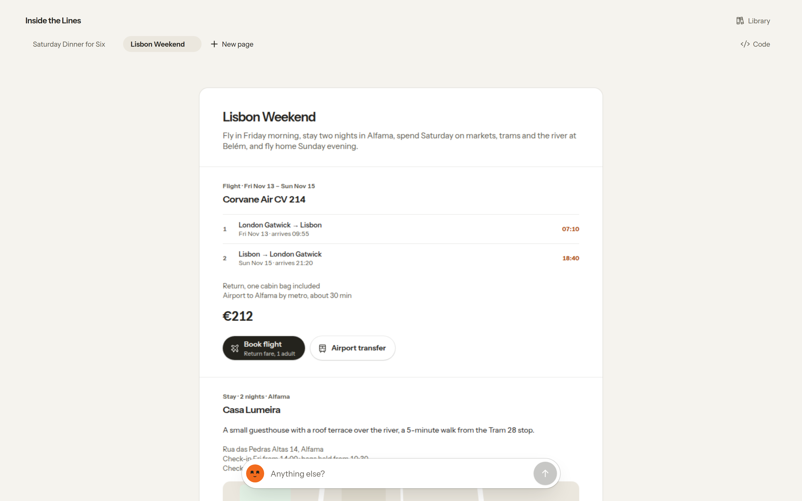
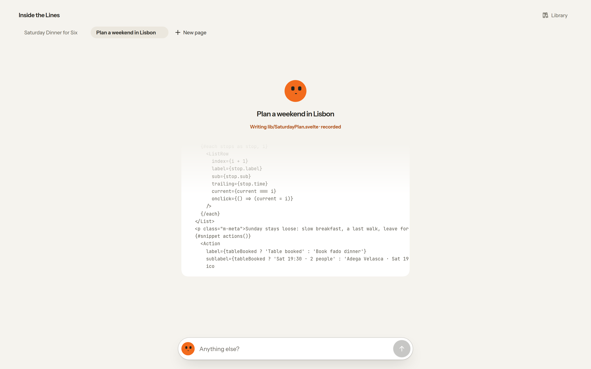
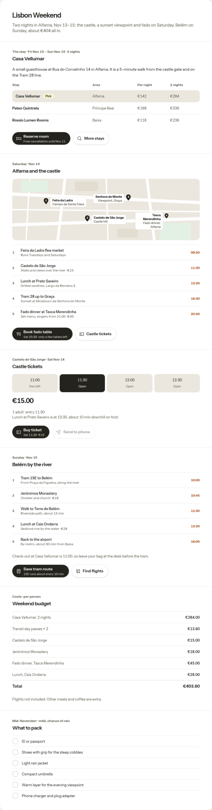
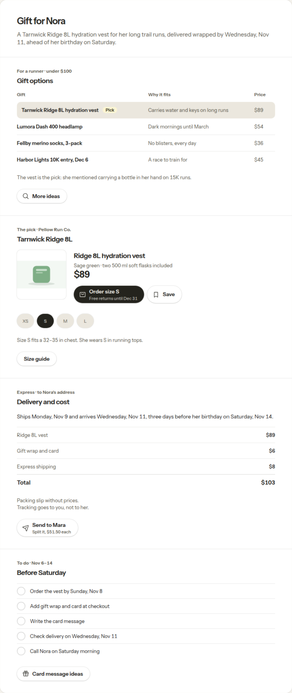
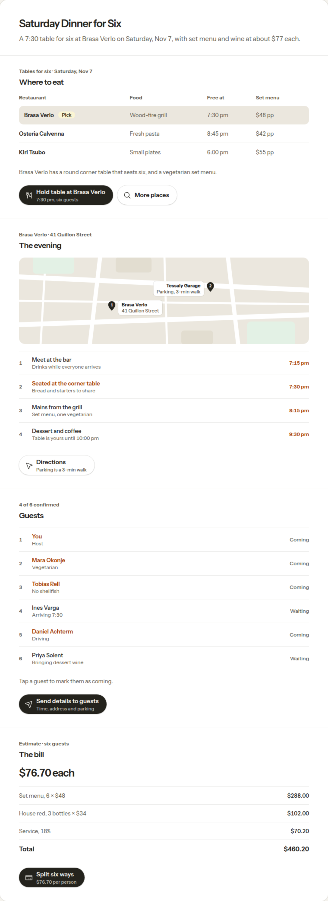
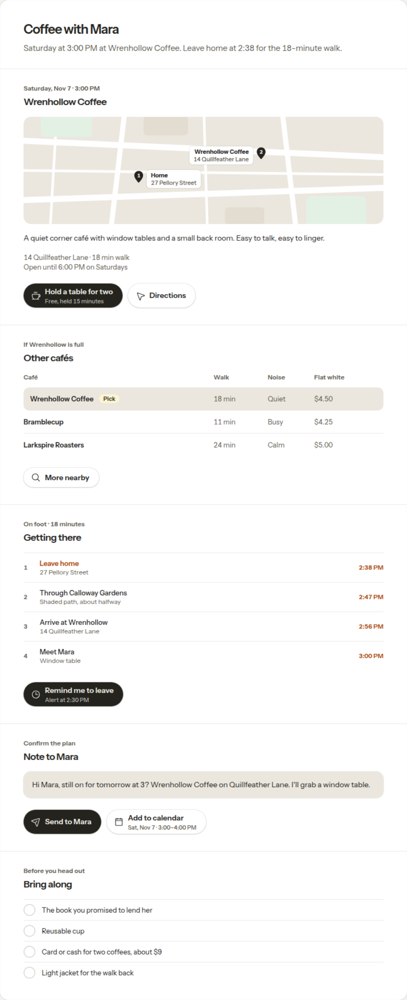
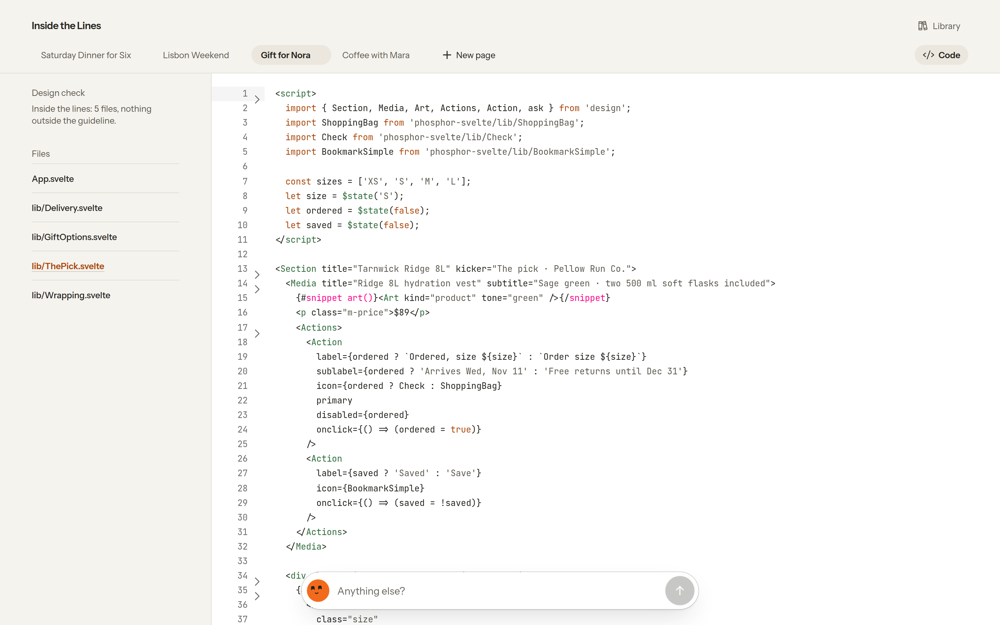
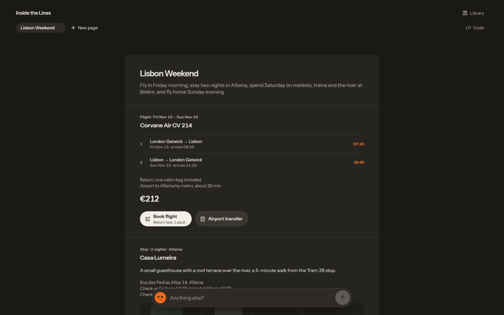
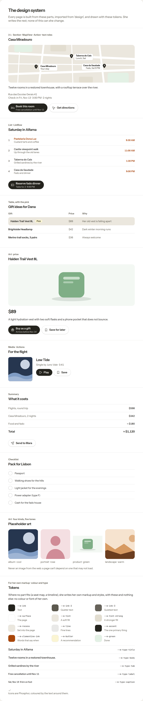

# Inside the Lines

**Say what you're planning, and an AI model writes a live page for it on the spot: real Svelte code, running in your browser. A design check reads that code and keeps it inside the lines of one design system.**

An experiment in generative UI: no apps, no folders, one page per task, written on the spot. It wears [Klementine](https://klementine.net)'s design, voice and face. All people, places and products in the examples are made up.



## Try it

```bash
git clone https://github.com/simon-lund/inside-the-lines.git
cd inside-the-lines
npm install
npm run dev
```

Open http://localhost:5173. The four examples are recorded and work **without an API key**, and so does the first button you press on each. For anything else, copy `.env.example` to `.env` and set one key:

| Provider | Key | Default model (`AI_MODEL`) |
|---|---|---|
| Anthropic | `ANTHROPIC_API_KEY` | `claude-opus-5-5` |
| OpenAI | `OPENAI_API_KEY` | `gpt-6-astra` |
| Mistral | `MISTRAL_API_KEY` | `mistral-large-latest` |

With several keys set, `AI_PROVIDER` picks one. A page takes 20 to 60 seconds to write. Pages compile in the Svelte REPL, which loads the compiler from a CDN, so even the recordings need a network connection.

## What you can do

- **Say what you're planning:** *"Plan a weekend in Lisbon"*. She writes the page while you watch: `App.svelte`, then one component per section.
- **Use the page.** It's live. An action that settles something switches on the spot (*Reserve room* → *Room reserved*). An action that shows more calls `ask()`, and she writes a new section right below the one you pressed.
- **Ask for more.** *Anything else?* changes the page or adds to it.
- **Read the code.** *Code* shows every file she wrote, next to what the design check found.
- **See what she builds with.** The *Library* shows every part of the design system, live, and its tokens.
- **Keep several pages.** They stay in your browser.



| A button in the page, pressed | Gift for a runner | Dinner for six | Coffee with Mara |
|---|---|---|---|
|  |  |  |  |

## Free code, kept on design

Letting a model generate UI usually ends one of two ways: it looks great once and drifts every time after, or it's boxed into a fixed set of blocks and can't surprise you. Here the model writes real code, with its own markup, styles, state and blocks (a seat map, a time-slot picker), and a design guideline holds it: checked in the code, not hoped for in the prompt.

```
intention ──► model ──► Svelte files ──► design check ──► Svelte REPL (compiles, runs in a sandboxed frame)
                ▲                            │
                └────── one repair round ◄───┘
```

1. **The design system is a library** ([`src/lib/design/`](src/lib/design)): Canvas, Page, Section, Action, Table, MapView, Summary, Checklist and more, plus the tokens for colour, type, space and motion. Its files are seeded into every page's workspace as `design/` and imported as `'design'`. They're locked: anything the model writes there is dropped.
2. **The guideline** ([`page-prompt.ts`](src/lib/server/page-prompt.ts)) gives the model room (its own markup, styles and state) and sets the lines: colours and fonts only through the tokens, everything in a section, one primary action per section, no cards in cards, no emoji, no images from the web, no imports beyond the design system, Svelte and Phosphor icons.
3. **The design check** ([`design-check.ts`](src/lib/server/design-check.ts)) reads each file's Svelte syntax tree and follows the page as it renders, from `App.svelte` through the page's own components, snippets and either branch of an `{#if}`. So a helper used inside a section isn't mistaken for content outside one. Thirteen rules, each with a stable code: `raw_color`, `raw_font`, `content_outside_section`, `nested_section`, `extra_primary`, `foreign_import` and more.
4. **One repair round.** What the check finds goes back to the model on its own, while the page already shows. Whatever survives shows as *2 things outside the lines*, with *Fix*. A page that doesn't compile or throws gets *Fix it*, which sends the error back with the code.
5. **Every rule has two tests:** one that it fires, and one that the nearest legitimate pattern passes. A false finding costs a repair round, so the passes matter as much.



Google's [Generative UI](https://research.google/blog/generative-ui-a-rich-custom-visual-interactive-user-experience-for-any-prompt/) (2025) has Gemini design and code a custom interface for each prompt, in a look of its own each time. This experiment asks the other question: how much freedom can a model have while every page stays on one design system?

## The design

The pages follow Klementine's design system: flat and warm, light or dark with your system, depth from fine lines rather than shadows. One primary action per section, in the page's own ink. Orange belongs to the assistant and to the words that say when something happens: her face, and the times in a day plan. Type is Instrument Sans, icons are [Phosphor](https://phosphoricons.com).

Her face in the input follows the pointer, with the gaze maths of Klementine's companion, and shows how she's doing: listening while you type, working while a page is written, needing you when something failed.



The [Library](src/routes/library/+page.svelte) is the design system as the model sees it: every part it imports from `'design'`, live, and the tokens its own markup is drawn with. A test makes sure it shows every part the system exports.



## How it's built

| Path | What |
|---|---|
| `src/routes/+page.svelte` | The app: the tabs, the page, the input |
| `src/routes/api/page/` | Writes a page or a change as a stream: recording or model, then the design check |
| `src/lib/server/design-check.ts` | The design check (+ tests) |
| `src/lib/server/page-prompt.ts` | The guideline, as the model reads it |
| `src/lib/pages/` | Client state, the REPL, the code view |
| `src/lib/app/` | The app's own parts: the input with her face, the tabs, the examples |
| `src/lib/design/` | The design system the pages are built from |
| `src/routes/library/` | The Library (+ test) |
| `src/lib/server/ai/` | Providers: Anthropic, plus one adapter for the OpenAI-compatible Chat Completions API (OpenAI, Mistral) |
| `vendor/repl/` | Svelte's REPL, vendored: the bundler, the sandboxed viewer, the editor |
| `recordings/` | Recorded answers, replayed without a key |

**Recordings.** Every answer is recorded under a key made of the request: what was asked, and the page's code at that moment. The same request replays the same answer, and a replay passes the design check again. `npm run record` drives the real app through the four examples and every `ask()` on their first page, asks again for any answer that doesn't pass the check first time or doesn't run, and leaves `recordings/` holding exactly those answers. A test checks that each one still replays and still passes, so a change to the check says which to record again.

**Checks:** `npm test` (the design check, the recordings, the Library), `npm run check` (types), `npm run screenshots` (regenerates `docs/screenshots/` against a dev server on port 5199).

## Credits

- Where it started: Jason Yuan's [Mercury OS](https://uxdesign.cc/introducing-mercury-os-f4de45a04289) (2019), an OS built around intentions.
- **Klementine** ([klementine.net](https://klementine.net)), which I also build: the design system, the face and the voice.
- The [Svelte REPL](https://github.com/sveltejs/svelte.dev/tree/main/packages/repl), which compiles and runs every page. It's vendored in `vendor/repl/` under its MIT licence ([`LICENSE`](vendor/repl/LICENSE)).
- [Phosphor](https://phosphoricons.com) icons, [Instrument Sans](https://fonts.google.com/specimen/Instrument+Sans), [SvelteKit](https://svelte.dev).

## License

MIT, except Klementine's face: `KlementineFace.svelte`, `face-paths.ts` and the screenshots that show it stay © 2026 Simon Lund, all rights reserved. The vendored Svelte REPL keeps its own MIT licence. See [`LICENSE`](LICENSE).
