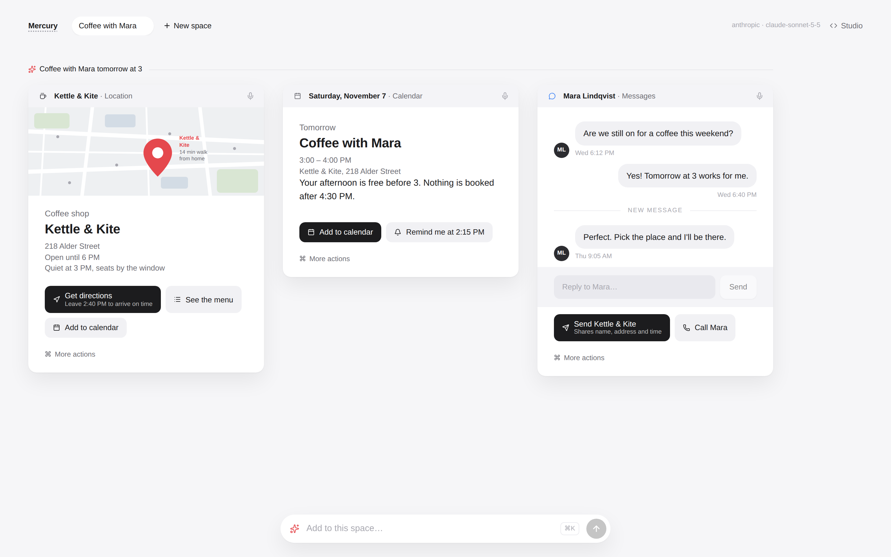
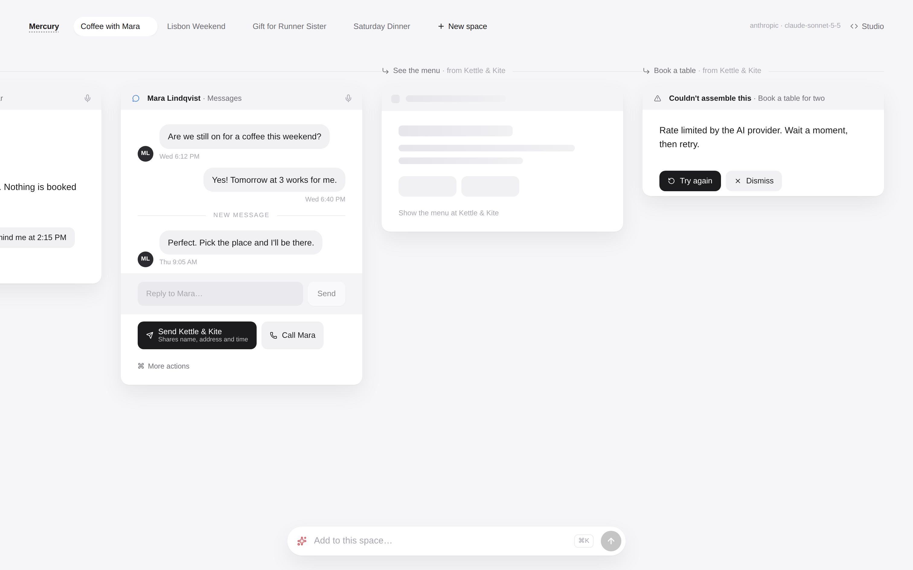
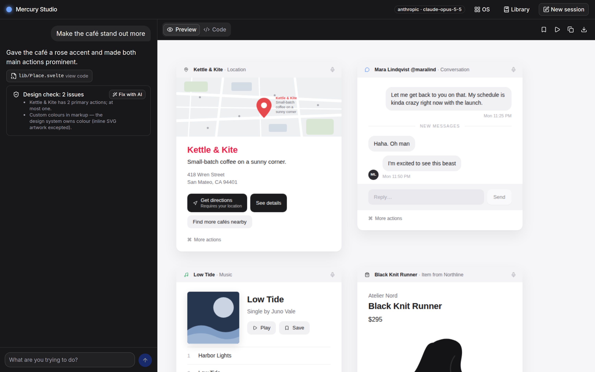
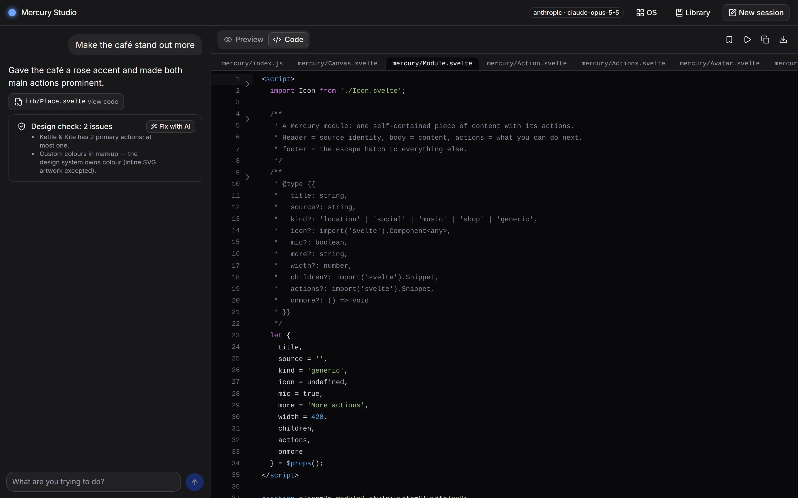
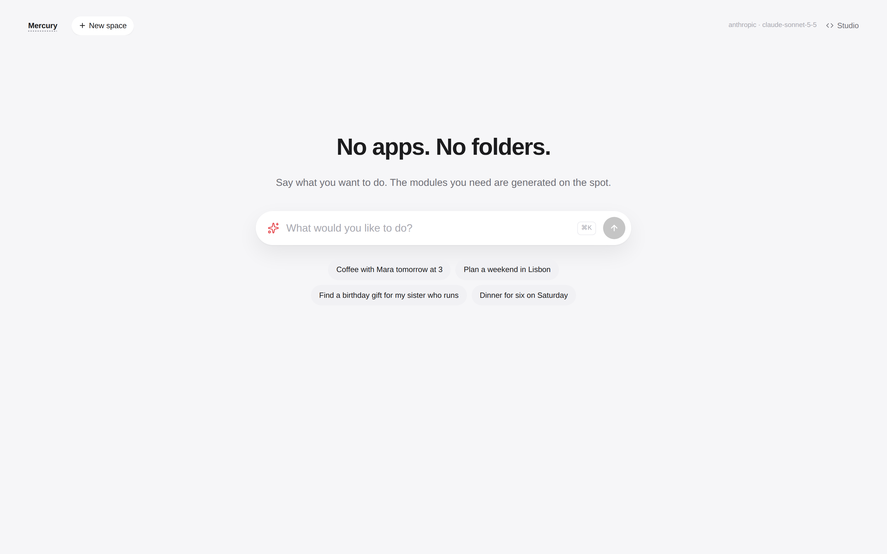
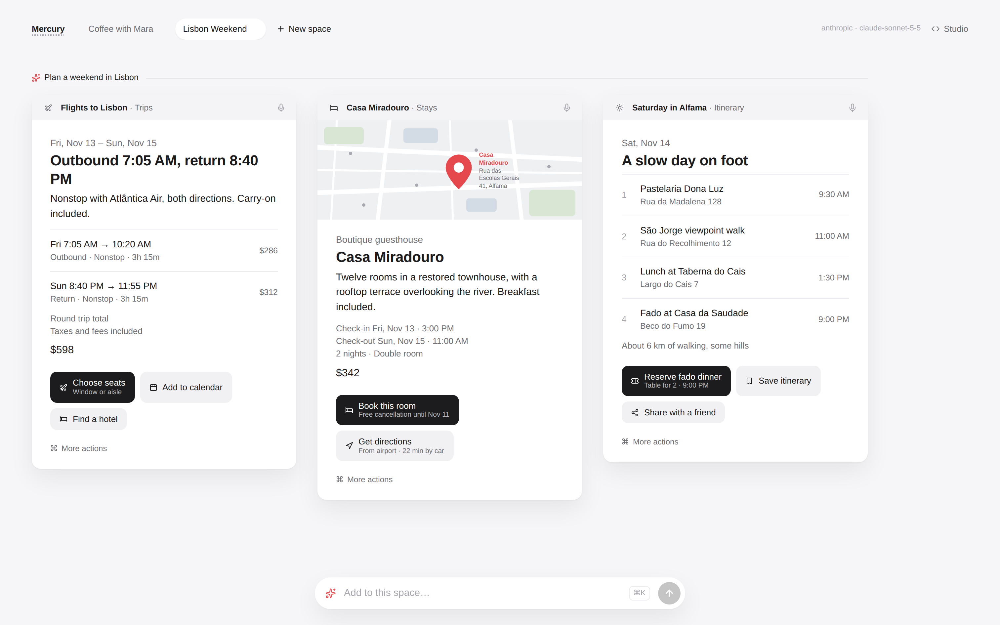
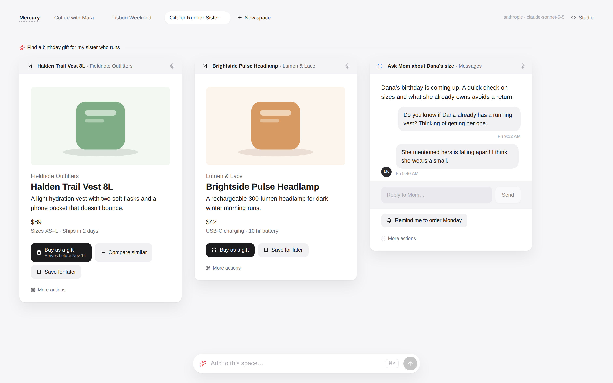
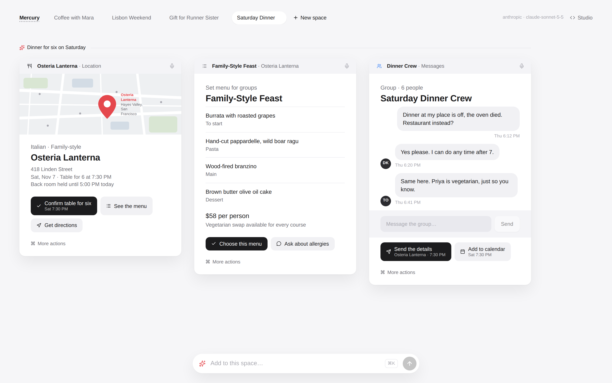
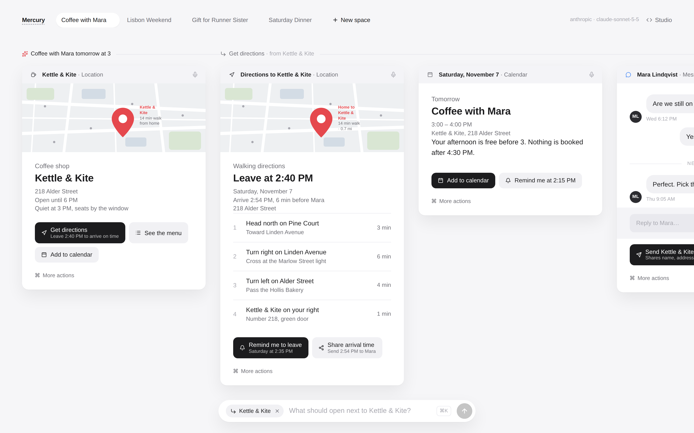

# Mercury OS prototype

**A clickable Mercury OS, where every module is generated by AI on the spot, and still can't leave the design system.**

In 2019, Jason Yuan published [Mercury OS](https://uxdesign.cc/introducing-mercury-os-f4de45a04289): an operating system without apps or folders. You state an intention, and the system assembles the content and actions you need as *modules*. It was published as images and videos; as far as I can tell, it was never released as something you could click.

This repo makes it clickable. Type an intention and an AI model assembles a Space of modules. Click an action and the next module is generated and slides into the flow. Nothing is pre-drawn; every module on screen was produced by the model a moment ago, from a fixed design vocabulary.

> Unofficial fan prototype. Not affiliated with Jason Yuan or Mercury OS. The concept, the module design and the terms (Modules, Flows, Spaces, Locus) are his. All people, places and products in the examples are made up.



## Try it

```bash
git clone https://github.com/simon-lund/mercury-os-prototype.git
cd mercury-os-prototype
npm install
npm run dev
```

Open http://localhost:5173. The four example intentions are recorded and work **without an API key**. For anything else, copy `.env.example` to `.env` and set one key:

| Provider | Key | Assembles modules (`AI_FAST_MODEL`) | Writes views in the studio (`AI_MODEL`) |
|---|---|---|---|
| Anthropic | `ANTHROPIC_API_KEY` | `claude-sonnet-5-5` | `claude-opus-5-5` |
| OpenAI | `OPENAI_API_KEY` | `gpt-6-luna` | `gpt-6-astra` |
| Mistral | `MISTRAL_API_KEY` | `mistral-small-latest` | `mistral-large-latest` |

With several keys set, `AI_PROVIDER` picks one. Both models can be overridden.

## What you can do

- **State an intention** in Locus, the bar in the middle: *"Coffee with Mara tomorrow at 3"*. A new Space opens, named after it, with the modules it needs in one horizontal band above Locus.
- **Click an action.** Actions either *open* something (the model generates the next module, placed right after the one you clicked) or *confirm* something (instant: "Add to calendar" → "Added").
- **⌘ More actions** on a module points Locus at it: whatever you type next opens next to that module.
- **Add to a Space** by typing in the docked Locus: a new Flow starts at the end of the band.
- **See why each module is there.** A line runs across each Flow: it starts with the intention you typed, and marks every module that an action opened (*↳ Get directions · from Kettle & Kite*).
- Remove modules, close Spaces, start new ones. Spaces are kept in your browser.

| Clicking "Get directions" generates the next module | Loading and error states stay local to their slot |
|---|---|
|  |  |

## Generated on the spot, kept on design

Letting a model generate UI live usually means one of two things: it looks great once and drifts every time after, or it's so constrained that it can't surprise you. Here the model has a lot of room (any intention, any content, any combination of modules), but it **never writes UI**. It fills in a fixed vocabulary, and the design system draws it.

```
intention ──► model ──► JSON in the module vocabulary ──► sanitizer ──► design-system components
                                                          (guardrail)
```

1. **The vocabulary** ([`src/lib/os/spec.ts`](src/lib/os/spec.ts)): a module has a title, a source, a kind and up to eight blocks (map, kicker, title, text, meta, price, media, art, list, message, divider, reply), plus up to four actions. There is no block for "custom HTML", no colour field, no CSS.
2. **The sanitizer** ([`src/lib/os/sanitize.ts`](src/lib/os/sanitize.ts)): drops unknown block types, icons and fields, caps every string, keeps a map only as the first block and a reply bar only as the last, and demotes extra primary actions so each module has at most one. Every rule is pinned by a test.
3. **One repair round**: if the model's reply is unusable (not JSON, no modules left), the server tells it what was wrong once, then gives up with a clear error.
4. **The renderer** ([`SpecModule.svelte`](src/lib/os/components/SpecModule.svelte)) maps each block to a design-system component. It's the only way a module reaches the screen.

The result: the model can't produce an off-design module, because there is nothing off-design for it to say.

## The studio: the same design system, with real code

`/studio` is where the design system was built: chat on the left, a live Svelte REPL on the right (vendored from [svelte.dev](https://github.com/sveltejs/svelte.dev)). Here the model writes real multi-file Svelte apps, so it can do more than the OS vocabulary allows. That also means it can break the rules, and the guardrail has to work differently:

- **The design system is locked.** It's seeded into every workspace as `mercury/`, importable as `'mercury'`, and any file the model emits under `mercury/` is discarded.
- **Every answer is checked** ([`src/lib/design-check.ts`](src/lib/design-check.ts)): it must import the design system, use exactly one `<Canvas>`, put content in `<Module>`s without nesting them, have at most one primary action per module, and use no custom colours (inline SVG artwork excepted), emoji or external images.
- **Violations go back to the model** for one automatic repair round. Whatever survives stays visible on the message, with *Fix with AI*.

In practice the model rarely trips the check. Asked outright to make the café's name rose red and both of its buttons primary, it declined and explained the rules instead. When a module is broken on purpose (as in the screenshot below), the repair round restores it: the colour goes, one primary action stays.

| The design check on a view broken on purpose | The locked design system, shown in the editor |
|---|---|
|  |  |

So there are two levels of guardrail: **by construction** in the OS (the model fills a vocabulary) and **by checking** in the studio (the model writes code, the code is checked).

## Showcase

| | |
|---|---|
|  |  |
|  |  |
|  | |

The design system's reference modules (a place, a conversation, a single, a product) are in the studio's library, rebuilt after Mercury OS's original mock-ups with made-up content.

## How it's built

| Path | What |
|---|---|
| `src/routes/+page.svelte` | The OS: Spaces bar, Flows, Locus |
| `src/lib/os/` | Module spec, sanitizer (+ tests), client state, OS components |
| `src/routes/api/os/` | Assembles modules: replay cache → model → sanitizer → repair round |
| `src/lib/mercury/src/` | The design system (Canvas, Module, Action, MapView, Media, Art, …), shared by the OS and the studio's REPL |
| `src/lib/server/ai/` | Provider layer: Anthropic, plus one adapter for the OpenAI-compatible Chat Completions API (OpenAI, Mistral) |
| `src/routes/studio/`, `src/lib/studio.svelte.ts` | The studio |
| `src/lib/design-check.ts` | The studio's design check (+ tests) |
| `vendor/repl/` | `@sveltejs/repl`, vendored (see `VENDOR.md`) |
| `os-demo/` | Recorded examples, replayed without a key |

**Recordings.** Every assembled result is cached by *what was clicked* (the intention, or the module + action), not by the whole space, so the same click replays the same module in any order. New results land in `.os-cache/` (gitignored); copy a file into `os-demo/` to ship it. That keeps demos instant and makes the examples work offline. `npm run record` clicks through the four examples in the real app (each intention plus up to two actions) and only spends calls on what isn't recorded yet.

**Tests and checks:** `npm test` (sanitizer and design check), `npm run check` (types), `npm run screenshots` (regenerates `docs/screenshots/` against a running dev server on port 5199).

**A gotcha discovered the hard way:** the REPL's `Bundler.bundle()` creates `$effect.root`s. Calling it during component init silently kills the page's reactivity after first paint, so it runs after mount (see `Studio.init()`).

## Credits

- **Mercury OS** by [Jason Yuan](https://uxdesign.cc/introducing-mercury-os-f4de45a04289) (2019): the concept, the module design and its vocabulary. This is an unofficial prototype of it.
- **Svelte REPL** from [sveltejs/svelte.dev](https://github.com/sveltejs/svelte.dev) (MIT), vendored in `vendor/repl/`.
- [shadcn-svelte](https://shadcn-svelte.com), [bits-ui](https://bits-ui.com) and [lucide](https://lucide.dev) icons.

## License

MIT, see [LICENSE](LICENSE). The vendored REPL keeps its own MIT license.
